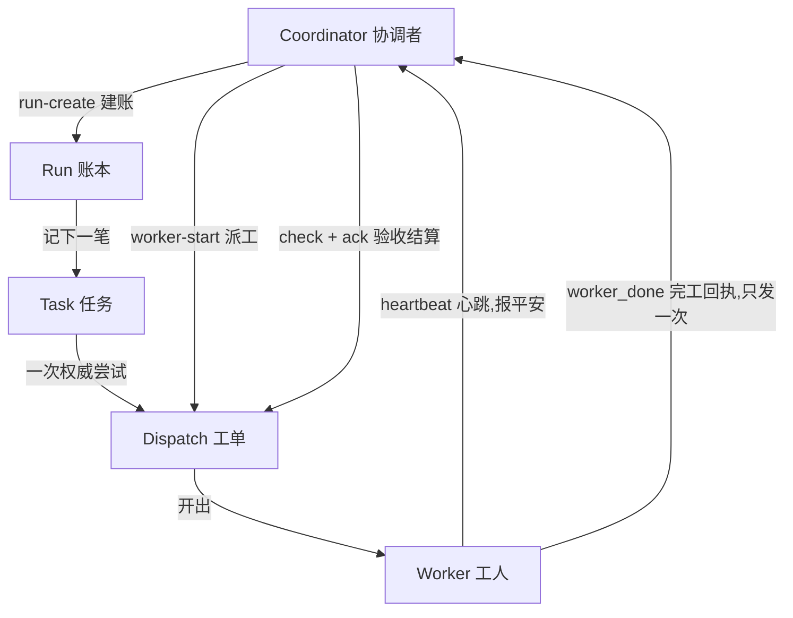
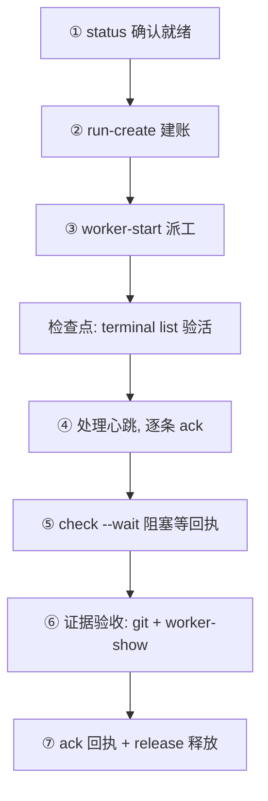
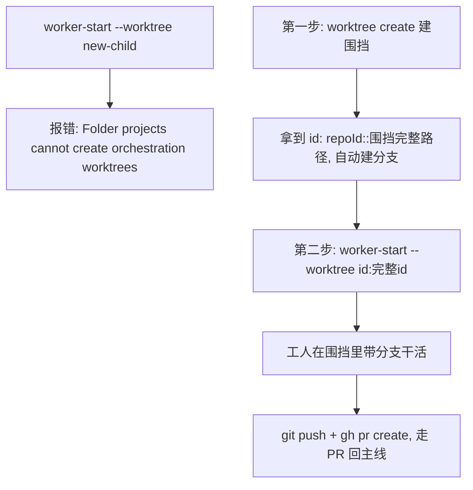

# Orca 编排实战白皮书

> **目标读者**:会动手但没接触过 Orca 编排的人(homelab 玩家、独立开发者)。读完本白皮书,你应该能**不看任何外部资料,独立完成一次完整的编排测试**。
>
> **纪律声明**:本文所有命令均抄自本仓库 `素材/01-命令序列.md` 的实测原文(全部于 2026-10-28 实测通过),未编造任何参数。约定:下文直接写 `orca`,实际调用时用完整路径 `/Applications/Orca.app/Contents/Resources/bin/orca`,或先 alias。

## 1. 这是什么

**一句话定位**:Orca 编排把"派 agent 干活、自动回执、结果入库"从手工拼装变成一条命令。

先解释两个基础词:

- **agent(智能体)**:一个能自己开终端、读写文件、跑命令的 AI 助手(比如 Claude)。你给它一段任务说明,它自己动手干,不用你逐行喂指令。
- **编排**:让"派活 → 盯活 → 收活 → 验收 → 入库"这条链路自动化——由系统记账、派工、收回执,而不是你人肉盯着屏幕。

它解决什么问题?没有编排时,让 agent 干活的每一步都是手工的:自己开终端、自己把需求打进去、自己盯屏幕判断"干完没有"、自己核对文件改得对不对。走神一下,就可能对着一个早就退场的工人空等半小时,或者对着一个根本没跑起来的 agent 说"流程符合预期"。有了编排:协调者发一条 `worker-start`,系统自动建账、开新终端、把身份与任务说明书注入给工人;工人按节奏报心跳,干完自动发完工回执;协调者查证据后结算。全程有账本可查、有回执可等、有状态可看——把"我看着它跑"换成"系统替我记账"。

## 2. 核心概念

这张图讲什么:一张图看清编排世界七个核心名词谁连着谁——协调者建账,账本里记任务,任务通过一次权威尝试(工单)落到工人头上,工人用心跳与回执向协调者汇报,协调者验收后结算工单。



逐节点大白话注释:

- **Coordinator(协调者)**:发起编排的那个终端。你(或你的主 agent)坐在协调者位置上,负责建账、派工、等回执、验收、结算。判断你是不是协调者,只看一件事:你要不要监督、等结果、做决策——要,就走第三章那套监督循环。
- **Run(账本)**:一次编排的总记录本。它只记账,**不调度任何人**。建账命令返回的 run id,是你后续一切查询的钥匙。
- **Task(任务)**:账本里记的"要干的活"本身,内容就是一张自包含的五要素任务卡(五要素见第三章第③步)。
- **Dispatch(工单)**:任务的一次**权威尝试**。"权威"的意思:工人的生命周期身份(任务 ID、派工 ID)只由系统经工单注入,工人不许自造、改写、扩展。
- **Worker(工人)**:被派进新终端、按工单里的任务卡干活的 agent。工人收到系统注入的 **preamble**(开场说明书,含任务 ID 与派工 ID),照卡干活;有疑问用阻塞式提问找协调者,不开本地问答。
- **heartbeat(心跳)**:工人定期发出的"我还活着"消息。注意:**心跳只证明活着,不证明完成**——别看到心跳就以为活干完了。
- **worker_done(完工回执)**:工人干完后发出的最终报告,带三句执行摘要、两个生命周期 ID 和明确的成败结论,**只发一次**。它也不等于验收通过——验收要看第五章的证据三件套。

一句话串起来:**协调者建账,账本记任务,任务经工单派给工人;工人靠心跳报平安,靠回执交作业;协调者不信摘要、只信证据,验收后结算工单。**

## 3. 七步标准流程

这张图讲什么:协调者从零到结算的七步监督循环,每步做什么、下一步去哪,以及两个最容易出事的检查点(启动后验活、回执后查证据)。



逐节点大白话注释:

- **① status 确认就绪**:开跑前先确认工具本身活着,磨刀不误砍柴工。
- **② run-create 建账**:开一本新账,拿到 run id。
- **③ worker-start 派工**:把活派出去,拿到 taskId 和 dispatchId。
- **检查点:验活**:启动类命令"返回成功"不等于工人真的活了,必须去看世界状态。
- **④ 处理心跳**:工人报平安,你逐条签收;心跳不是完成,别提前收摊。
- **⑤ check --wait 等回执**:用官方的阻塞等待,不自己写轮询。
- **⑥ 证据验收**:不听摘要,查 git 世界和系统状态。
- **⑦ 结算**:签收回执、释放工人,这一单关账。

下面每步给出命令原文、干什么、怎么确认成功。

### ① 确认 runtime 就绪

```bash
orca status --json
```

- **干什么**:确认 app 和 runtime 都是 ready(工具本体活着,后面的命令才有意义)。
- **怎么确认成功**:输出里看到 `runtime.state="ready"`,`runtime.reachable=true`。

### ② 建编排 Run(账本)

```bash
cd <你的仓库目录>
orca orchestration run-create --objective "<目标一句话>" --json
```

- **干什么**:开一本账。协调者就是发起这条命令的终端,返回里带 `coordinator_handle`。
- **怎么确认成功**:输出形如 `{"run":{"id":"run_xxx","objective":"...","coordinator_handle":"term_xxx",...}}`,把 run id 记下来。

### ③ 派工人

```bash
orca orchestration worker-start --spec '<五要素任务卡>' --worktree current --agent claude --json
```

- **干什么**:把任务卡派给一个新终端里的工人。`--worktree current` 解析为**协调者终端在 Orca 里绑定的那个工作区**——与你 shell 当前 `cd` 到的目录无关,cd 不决定工人的落点(需要隔离时走第四章的两步法)。任务卡**五要素**:Target(目标文件,**写绝对路径**,如 `Target: /Users/<你>/myrepo/白皮书/orca-orchestration.md(你的 worktree 副本)`)/ Change(具体产出)/ Constraints(不许碰什么)/ Ownership(归谁改)/ Observable acceptance(什么证据算完成,**同样写绝对路径**,如 `diff 只含 /Users/<你>/myrepo/白皮书/orca-orchestration.md`)——卡片必须自包含,工人只看它干活;正因工人落点不随你的 `cd` 变化,这两项必须用绝对路径,相对路径对工人有歧义。<!-- issue#3 -->
- **怎么确认成功**:输出 `{"taskId":"task_xxx","dispatchId":"ctx_xxx"}`,两个 ID 都记下来。**核对落点**:返回 JSON 里的 `effects[].worktree` 必须与预期的仓库一致;不一致立即停车,改用 `--worktree id:完整id` 显式指定后重派。注意这条重派路径有前提:零上下文的新 clone 里 Orca 还不认识这个仓库,须先 `orca repo add --path <绝对路径>` 在 Orca 注册、拿到 repoId,再走第四章 `worktree create` 建围挡,才有完整 id(`id:<repoId>::<path>`)可写进 selector;未注册前不存在任何可指定的围挡,唯一落点就是注册后的当前工作区(即 `--worktree current` 解析到的那个),先补注册再谈重派。**启动后必须验证工人真的活了**:`orca terminal list` 里出现新终端。<!-- issue#3 --> <!-- issue#7 -->

### ④ 心跳处理

```bash
orca orchestration check --run <run_id> --json
orca orchestration check --run <run_id> --ack <deliveryId> --json
```

- **干什么**:心跳是**可选信号**——快任务可能一条心跳都没有,`check` 首次取信直接就是 `worker_done`,这同样正常,不要当成异常。有心跳时,工人发 `type=heartbeat` 的消息报平安,第一条 `check` 取信,返回 `deliveryId` + messages;第二条按 FIFO(先进先出)逐条 `ack`(**ack** = 签收,告诉系统"这封信我读过了")。**没签收的信会重放,还会遮住后续新信**,所以读一条、签一条。<!-- issue#8 -->
- **怎么确认成功**:ack 之后再次 check,已签收的信不再出现。
- **纪律**:**心跳 ≠ 完成**。收到心跳只说明工人活着,继续等,不要提前下结论。

### ⑤ 阻塞等待完工回执

```bash
orca orchestration check --run <run_id> --ack <deliveryId> --wait --types "worker_done,escalation,question" --timeout-ms 540000 --json
```

- **干什么**:官方等待姿势,一条命令阻塞等待三类消息:完工回执(worker_done)、升级(escalation)、提问(question)。**不要自己写轮询脚本**——历史上自造轮询翻过车(见第六章坑 2)。
- **怎么确认成功**:收到 `type=worker_done`,payload 含 `outcome`/`filesModified`/`taskId`/`dispatchId`。
- **连续三次空等怎么办**:停止盲等,用 `orca orchestration worker-list --run <run_id> --include-remote --json` 枚举工人,按每行 `nextAction` 的字面 argv 行动。**"没有消息"永远不构成停止、重试或释放的依据**。

### ⑥ 证据验收(不听摘要,查世界)

```bash
git -C <工作区> log --oneline -3 && git show --stat <新提交>
orca orchestration worker-show --dispatch <dispatchId> --json
```

- **干什么**:回执只是工人"自述干完了",验收要看世界里的真凭实据——git 里有新提交、diff 对得上任务卡;系统里工单状态是成功。
- **怎么确认成功**:`worker-show` 输出 `state:"succeeded"`,`nextAction.kind:"release"`。
- **协议提醒**:有效的 worker_done 会**自动**结算 Task 和 Dispatch,不要再跟一条 `task-update --status completed`。

### ⑦ 结算:ack 回执 + 释放工人

```bash
orca orchestration check --run <run_id> --ack <回执的deliveryId> --json
orca orchestration worker-release --dispatch <dispatchId> --json
```

- **干什么**:签收回执、释放工人终端。每个结算的终端必须三选一:复用该终端派新活 / worker-retain(保留终端)/ worker-release(释放终端)。
- **怎么确认成功**:实测中,工人终端可能以 `"user_takeover" retained` 留在界面(**retained** = 系统留着这个终端,供你回看工人的操作记录),这是正常现象。

### 出问题了怎么查(按官方路径,不要瞎猜)

```bash
orca orchestration worker-show --dispatch <dispatchId> --json
```

看三样:`state`(succeeded/failed)、`liveness.verdict`(live/unverifiable/exited)、`nextAction.kind + nextAction.argv`——官方把下一步该跑的命令都替你算好了,照抄即可。

```bash
orca orchestration worker-list --run <run_id> --include-remote --json
orca terminal read --terminal <handle> --screen
```

`terminal read --screen` 看终端当前画面,**注意是快照不是实时**。

两条协议红线:其一,`worker-start` 非零退出**不要重启**,先读 receipt 的 failedStage,按官方恢复文档处理;其二,`dispatch --inject` 是逃生舱(会留下不受监督的进程),不是主路。另外,`--model`/`--effort` 参数**不构成监督**——要监督只有 `worker-start` 一个入口;只想把活丢给另一个 agent 而不监督,那是"交接"路线,用 orca-cli,不建 Run、不监控完成,那条路线"失联"是设计行为,不是 bug。

## 4. 隔离通道(两步法)

**为什么需要隔离**:当工人会大改文件、或多个工人会互相踩脚时,别让他们挤在同一个工作区,要给工人单独开一个"围挡"。**围挡**(worktree,工作树)= 同一个仓库的另一个独立工作目录,自动带自己的分支——工人在围挡里怎么改都不污染你的主工作区,改坏了直接拆围挡。

**为什么不能一步到位**:folder 型项目(playbook-demo 就曾是)直接执行 `worker-start --worktree new-child` 会报错:

```
Folder projects cannot create orchestration worktrees
```

正确姿势是两步:先 `worktree create` 建围挡,再 `worker-start --worktree id:完整id` 把工人派进去。

这张图讲什么:folder 项目直接要新围挡会被系统拒绝,正确路线是先建围挡拿到完整 id,再用完整 id 把工人派进围挡,工人在自己的分支里干活、成果走 PR 回主线。



逐节点大白话注释:

- **X / XE**:一步到位的错误尝试,以及系统的拒绝理由——folder 项目不支持编排自动开围挡,这条错路不要走。
- **A**:先手动建围挡(真 git worktree),自动建分支;名字会自动避让重名(同名围挡自动变成 xxx-2,别以为建错了)。
- **B**:建完围挡拿到完整 id,格式 `repoId::围挡完整路径`,这是下一步派工的钥匙。
- **C**:派工时 selector **必须用完整 id**(`id:<repoId>::<path>`),不能只用名字。
- **D**:工人在围挡分支里自由改,主线不受影响。
- **E**:成果通过 push + PR 审查回流主线,人审通过才合并。

命令原文:

```bash
# 第一步:先建围挡(真 git worktree,自动建分支,名字自动避让重名)
cd <仓库目录>
orca worktree create --repo name:<仓库名> --name <围挡名> --json
```

实测输出:`id: <repoId>::<围挡完整路径>`,`branch: refs/heads/<围挡名>`。

```bash
# 第二步:工人派进围挡(注意 selector 必须用完整 id,格式 id:<repoId>::<path>)
orca orchestration worker-start --spec '<五要素任务卡>' \
  --worktree "id:<repoId>::<围挡完整路径>" --agent claude --json
```

分支成果走 GitHub(接 PR 流程):

```bash
cd <围挡路径>
git push -u origin <分支名>
gh pr create --base main --head <分支名> --title "..." --body "..."
# 人审或 gh pr merge <PR号> --merge --delete-branch
```

用完清理(恢复初始):

```bash
orca orchestration reset --all                       # 清编排状态
orca terminal close --worktree name:<围挡名> --all    # 关围挡下全部终端
orca worktree rm --worktree name:<围挡名> --force     # 删围挡(注意:不删分支!)
cd <仓库> && git worktree prune && git branch -D <分支名>   # 删分支要单独做
git fetch --prune                                    # 清远程引用缓存
```

**放置纪律**(什么时候该用隔离通道):新工人 = 新终端,默认用 current 或指定已有工作区;**建 worktree 仅当用户要求或真实文件冲突**。不是每次派工都要围挡。

## 5. 验收纪律

三条铁律,全部来自真实翻车案例:

**铁律一:回执 ≠ 完成。** worker_done 是工人的自述。自述可以错、可以漏,验收的唯一标准是世界状态。

**铁律二:证据三件套,缺一不可。**

1. **回执内容**:工人说了什么(三句执行摘要 + outcome + filesModified);
2. **git 提交与 diff**:世界里真的多了提交、改了该改的文件吗?(`git log` / `git show --stat`);
3. **worker-show 状态**:系统怎么说?(`state:"succeeded"`,`nextAction.kind:"release"`)。

三样对得上,才算完成。

**铁律三:启动类命令必须验证世界状态。** 启动类命令(如 worker-start)成功返回 ≠ 世界真的变成它声称的样子:返回 taskId 不代表工人活了,要去 `orca terminal list` 看新终端真的出现。反过来,`terminal read` 读到的"空 shell"也不一定是失败——工人干完即退场,终端回到空闲 shell,此时"空"可能是"已结束",用 dispatch 状态(worker-show 的 state)说话,不要凭一张快照断生死。

## 6. 踩坑实录

八个真实案例(2026-10-27/28 亲历),每个按"错误做法 → 为什么错 → 正确做法"改写成教学案例。

### 坑 1:手工拼装编排流程,四连败

- **错误做法**:不读官方 skill,看着 --help 的参数名自己拼四步(launch → task-create → dispatch --inject → terminal send 喂话术),每个参数值靠想象填(`--from worker` 这种自造身份)。
- **为什么错**:绕过官方协议,用想象填补参数——--help 只给参数名,不给协议;生命周期权威只来自活跃的 Dispatch,自造身份会被系统拒收。
- **结果**:完工报告连发三封全被拒收;协调者干等一个永远不会来的回执。
- **正确做法**:读 `orca skills get orchestration` 全文,按 canonical loop(标准循环)用 worker-start 一条龙,生命周期 ID 由系统注入,不需要也不允许自造。改用官方姿势后一次通过。

### 坑 2:自制轮询 Monitor,信到了没抓到

- **错误做法**:不信任官方等待,自己写 Monitor(监控脚本)轮询 inbox,grep 盯任务/派工 ID。
- **为什么错**:对消息格式做格式假设;而官方 `check --wait` 从不需要知道格式。
- **结果**:工人回执到了,轮询脚本没匹配到,协调者误判"工人没干活"。
- **正确做法**:`check --wait` 阻塞等待,零格式假设。

### 坑 3:把"返回值"当"事实"

- **错误做法**:worker-start 返回 taskId 就当工人活了;terminal read 的一次快照("Meandering 42s")当"正在执行"。
- **为什么错**:启动类命令的成功返回 ≠ 世界真的变成它声称的样子。
- **结果**:对着一个已经干完退场的工人空等;对着一个根本没跑起来的 agent 说"流程符合预期"。
- **正确做法**:启动后必验证(terminal list 看新终端/读屏);判断"完成"用三层证据(回执 + git diff + worker-show.state)。

### 坑 4:skill 被 grep 一角就动手

- **错误做法**:213 行的官方 skill 只 grep 了 worker_done 片段就开始拼命令。
- **为什么错**:漏掉 canonical loop、角色路由、工人义务全部关键条款。
- **正确做法**:全文通读;根治方案是第七章的 skill 门禁(机器强制,不靠自觉)。

### 坑 5:folder 项目硬开编排围挡

- **错误做法**:`worker-start --worktree new-child` 直接用在 folder 型项目上。
- **为什么错**:folder 项目不支持编排自动开围挡,报 invalid_argument(`Folder projects cannot create orchestration worktrees`)。
- **正确做法**:两步法——先 `orca worktree create` 建围挡,再 `worker-start --worktree id:完整id`。

### 坑 6:工人干完退场,终端变"空 shell"

- **现象**:启动后 20 秒读终端,只有 shell 提示符,没有 claude 痕迹,疑似没起来。
- **真相**:工人干完即退场(quick 任务),终端回到空闲 shell。
- **正确做法**:查 worker-show(state=succeeded)+ 回执 + git,而不是断定失败。教训:**"空"可能是"已结束",用 dispatch 状态说话**。

### 坑 7(环境类):GitHub 间歇全断

- **现象**:gh/ssh 22/ssh 443 全部被代理层 reset(fake-ip 198.18.x.x),数分钟后自愈。
- **处理**:不硬莽;先走不依赖网络的部分,通道恢复再推。

### 坑 8(历史遗留,教学法案例):同名 worktree 自动避让

- **现象**:`worktree create --name isolation-demo` 第二次使用时,Orca 自动起名 isolation-demo-2,不留神会以为建错了。
- **处理**:知道这是自动避让即可,围挡照常用。

## 7. 安全带:skill 门禁

**为什么需要**:第六章坑 1、坑 4 的根因不是工具的错,是**绕过官方文档、用想象填参数**。口头纪律("记得先读 skill")对 agent 没有约束力——agent 该跳还是跳。所以把纪律做成机器强制,这就是 skill 门禁(gate,闸门):**读全文才登记,动作命令无登记即拦**。

**设计原理(三层机制)**:

1. **登记**:门禁脚本检测到完整的 `orca skills get <name>`(未被 grep/sed/head/tail 截断)时,把该 skill 记入 `~/.claude/skill-read-state.json`(带时间戳,7 天有效)。
2. **拦截**:Claude Code 的 PreToolUse hook(**hook** = 钩子,agent 每次要跑命令前先过这道闸)匹配 Bash 命令,发现"动作类" orca 命令(orchestration 全部动作 / worktree create|rm / agent launch / terminal create|send)而对应 skill 未登记(或过期)→ **deny**(拒绝执行),拒绝理由里直接给出解法命令。
3. **放行**:登记有效期内,动作命令正常执行。

**实现(两份文件)**:

- `~/.claude/hooks/orca-skill-gate.sh`:PreToolUse hook,拦截 + 登记(登记逻辑内置:放行 skills get 时顺手登记,不依赖不稳定的 PostToolUse)。
- `~/.claude/settings.json` 的 hooks.PreToolUse 挂载它(matcher: Bash,onFailure: block——hook 自身崩溃时宁可全拦)。

**官方规范要点(hook 字段名错一个字母就失效)**:

- 拒绝方式:exit 0 + stdout 纯 JSON:`{"hookSpecificOutput":{"hookEventName":"PreToolUse","permissionDecision":"deny","permissionDecisionReason":"..."}}`
- exit 1 是"非阻断错误",命令照跑——门禁绝不能 exit 1。
- permissionDecision 四个取值:allow/deny/ask/defer;deny 时 reason 直接给模型看。
- settings 改动需重启会话生效;交互会话要过 workspace trust 后 hook 才跑。

**边界(诚实声明)**:门禁保证"skill 全文被注入过上下文",不能机械保证"被理解"。但本仓库全部历史事故都源于前者,后者尚未发生过——这条防线挡住了 100% 的已知病例。

**skill 常驻(另一半防线)**:

```bash
orca skills install --skill orchestration --skill orca-cli --skill computer-use
```

把官方指南装进 Claude Code 技能列表,每次会话可见其存在与触发条件——消灭"不知道有文档"这个跳过根因。

## 8. 附录:命令速查表

一张表汇总全部已验证命令(与 `素材/01-命令序列.md` 一一对应):

| 场景 | 命令 | 要点 |
|---|---|---|
| ① 确认就绪 | `orca status --json` | 看 runtime.state="ready"、runtime.reachable=true |
| ② 建账 | `cd <你的仓库目录>` 后 `orca orchestration run-create --objective "<目标一句话>" --json` | 返回 run id、coordinator_handle |
| ③ 派工(快车道) | `orca orchestration worker-start --spec '<五要素任务卡>' --worktree current --agent claude --json` | current=协调者终端在 Orca 绑定的工作区,与 shell 的 cd 目录无关;返回 taskId、dispatchId,并核对 effects[].worktree 落点与预期仓库一致;之后 terminal list 验活 <!-- issue#3 --> |
| ④ 读信 | `orca orchestration check --run <run_id> --json` | 返回 deliveryId + messages |
| ④ 签收 | `orca orchestration check --run <run_id> --ack <deliveryId> --json` | FIFO 逐条 ack |
| ⑤ 等回执 | `orca orchestration check --run <run_id> --ack <deliveryId> --wait --types "worker_done,escalation,question" --timeout-ms 540000 --json` | 官方等待姿势,不写轮询 |
| ⑥ 验收 | `git -C <工作区> log --oneline -3 && git show --stat <新提交>` | 查 git 世界 |
| ⑥ 验收 | `orca orchestration worker-show --dispatch <dispatchId> --json` | 期望 state:"succeeded"、nextAction.kind:"release" |
| ⑦ 签收回执 | `orca orchestration check --run <run_id> --ack <回执的deliveryId> --json` | 有效的 worker_done 自动结算,勿再 task-update |
| ⑦ 释放工人 | `orca orchestration worker-release --dispatch <dispatchId> --json` | 终端可能以 "user_takeover" retained 留在界面 |
| 围挡·第一步 | `cd <仓库目录>` 后 `orca worktree create --repo name:<仓库名> --name <围挡名> --json` | 输出 id 与 branch;名字自动避让重名 |
| 围挡·第二步 | `orca orchestration worker-start --spec '<五要素任务卡>' --worktree "id:<repoId>::<围挡完整路径>" --agent claude --json` | selector 必须用完整 id |
| 推分支 | `cd <围挡路径>` 后 `git push -u origin <分支名>` | 围挡分支的成果 |
| 开 PR | `gh pr create --base main --head <分支名> --title "..." --body "..."` | 人审 |
| 合 PR | `gh pr merge <PR号> --merge --delete-branch` | 人审通过后 |
| 清编排状态 | `orca orchestration reset --all` | 恢复初始 |
| 关围挡终端 | `orca terminal close --worktree name:<围挡名> --all` | 围挡下全部终端 |
| 删围挡 | `orca worktree rm --worktree name:<围挡名> --force` | 注意:不删分支! |
| 删分支 | `cd <仓库> && git worktree prune && git branch -D <分支名>` | 与删围挡分开做 |
| 清远程缓存 | `git fetch --prune` | 清远程引用缓存 |
| 诊断·工单 | `orca orchestration worker-show --dispatch <dispatchId> --json` | state / liveness.verdict / nextAction.argv |
| 诊断·清单 | `orca orchestration worker-list --run <run_id> --include-remote --json` | 按 nextAction 字面 argv 行动 |
| 诊断·读屏 | `orca terminal read --terminal <handle> --screen` | 快照,不是实时 |

——完——
